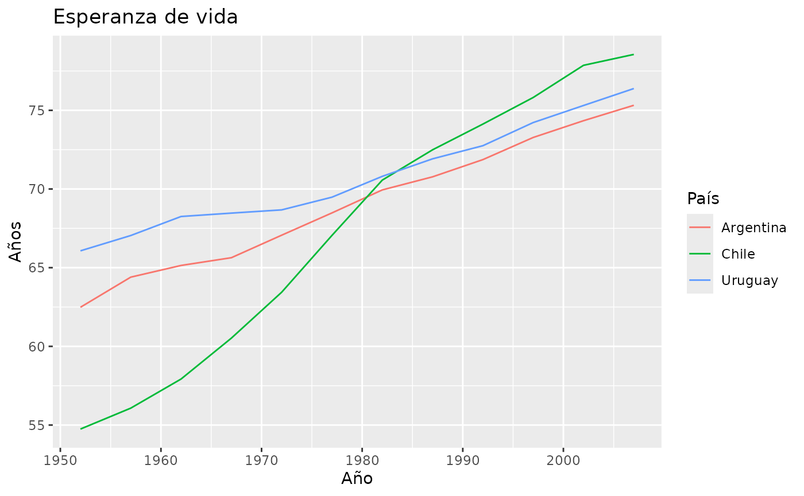

# Introducción a paisesR

``` r

library(paisesR)
```

## Introducción

paisesR ayuda a explorar la esperanza de vida y el PBI per cápita de los
países de Sudamérica.

## El conjunto de datos

``` r

head(paises_sudamerica)
#>        pais anio esperanza_de_vida pib_per_capita
#> 1 Argentina 1952            62.485       5911.315
#> 2 Argentina 1957            64.399       6856.856
#> 3 Argentina 1962            65.142       7133.166
#> 4 Argentina 1967            65.634       8052.953
#> 5 Argentina 1972            67.065       9443.039
#> 6 Argentina 1977            68.481      10079.027
```

## Resumen de un país

``` r

resumen_pais(paises_sudamerica, "Argentina")
#> # A tibble: 1 × 3
#>   pais      esperanza_media pib_medio
#>   <fct>               <dbl>     <dbl>
#> 1 Argentina            69.1     8956.
```

## Gráfico de esperanza de vida

``` r

grafico_esperanza(paises_sudamerica, c("Argentina", "Chile", "Uruguay"))
```



## Ranking de países

``` r

ranking_paises(paises_sudamerica, variable = "esperanza", n = 5)
#> # A tibble: 5 × 2
#>   pais      promedio
#>   <fct>        <dbl>
#> 1 Uruguay       70.8
#> 2 Argentina     69.1
#> 3 Chile         67.4
#> 4 Paraguay      66.8
#> 5 Venezuela     66.6
```
